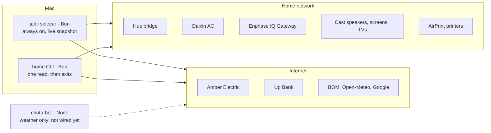

# @khalido/home

My house as a TypeScript import. Philips Hue, a Daikin AC, Enphase solar and the Google Cast speakers and screens and AirPrint printers on the local network, Amber Electric's live prices, Up Bank's spending and the weather from the cloud. One small library plus a `home` command, used by a Mac launcher (Bun) and a Telegram bot (Node).

```ts
import { createHome } from "@khalido/home";
import { hue } from "@khalido/home/hue";

const home = createHome([hue({ ip, bridgeId, key, ca })], (snapshot) => render(snapshot));
home.start(signal);           // connects, reads everything, follows the event stream, reconnects
home.snapshot().hue?.status;  // "connected": from memory, never from the bridge
home.part("hue")?.state;      // typed: HueSnapshot, from the integration's name
```

Every integration keeps its own state current, by event stream or on its own timer. Callers read one snapshot, from memory, in microseconds. [Home Assistant](https://www.home-assistant.io/) is the inspiration and the reference; this is a few files you import, covering only the devices I own. Why it is shaped like this: [docs/philosophy.md](docs/philosophy.md).

## The map



There is no server. Each app imports the library, runs its own `createHome`, and talks to the devices itself; each keeps its own snapshot in memory. Nothing passes between the apps.

```
src/
  home.ts       createHome and the Integration contract
  config.ts     the home config: schema, checkHome, loadHome
  discover.ts   devices found by identity, the relocator, the address book
  connector.ts  what connectors share: one error, one timeout, a fetch the run can cancel
  manifest.ts   what each connector declares about itself; the CLI and .env.example derive from it
  poll.ts  clock.ts  energy.ts  locate.ts  index.ts
  finders.ts    Node-side discovery (macOS dns-sd, Linux avahi-browse, UDP), the address cache file
  cli/          the home command on cac, the only code that reads your shell
  connectors/   one folder per device or service, each with its own README
    hue/  daikin/  enphase/  cast/  printers/  amber/  weather/
docs/           design notes, decisions, investigations, the handover
skills/         draw-home: an agent draws your home as an SVG; use-home: an agent reads and runs it safely
```

## Connectors

| Connector | Reads | Writes | README |
|---|---|---|---|
| `hue` | lights, rooms and scenes over the bridge's local event stream (`local_push`) | lights, rooms, scenes, spaced to Signify's limits | [hue](src/connectors/hue/README.md) |
| `daikin` | the AC over its local `dsiot` API every 120 s (`local_polling`) | built, not yet tried on the unit | [daikin](src/connectors/daikin/README.md) |
| `enphase` | solar production and consumption from the IQ Gateway every 60 s (`local_polling`) | none | [enphase](src/connectors/enphase/README.md) |
| `cast` | every Cast device and speaker group over its own socket (`local_push`) | volume, mute, stop, announcements; tested on a fake socket only | [cast](src/connectors/cast/README.md) |
| `printers` | AirPrint printers over IPP every 120 s: state, toner, paper, last seen (`local_polling`) | none; untried on a live printer | [printers](src/connectors/printers/README.md) |
| `amber` | live import and feed-in prices every 60 s (`cloud_polling`) | none | [amber](src/connectors/amber/README.md) |
| `up` | two months of spending by Up's categories, top merchants, what needs a category, every 15 min (`cloud_polling`) | a category or a tag on one transaction, webhooks; only as `home up` verbs, untried | [up](src/connectors/up/README.md) |
| `weather` | now, forecast, sky and the sun from BOM, Open-Meteo and Google every 15 min (`cloud_polling`) | none | [weather](src/connectors/weather/README.md) |

`energyNow` combines Enphase and Amber into cost or earnings per hour and the grid flow. Each connector exports a factory returning an `Integration` (`src/home.ts`): a name and a `run(signal, update)` that keeps its state current. `createHome` runs them side by side; one failing marks itself `unavailable` and the rest carry on. To add one, follow [AGENTS.md](AGENTS.md).

## Install and run

Not on npm yet. Clone it, then:

```sh
bun install && bun test        # tests run on fixtures; no device needed
bun run build                  # dist/, what `import "@khalido/home"` loads
bun link                       # puts `home` on your PATH; `bun link @khalido/home` in your app
home                           # status: each connector, connected or what it still needs
home amber                     # one connector's lines; every connector has its verb, `home --help` lists them
home discover                  # what answers on this network, and which of it this package supports
home probe                     # read-only checks, no keys
```

The library never reads your environment or a file: callers pass addresses, keys and a `fetch`. It is developed on Bun and meant to run on Node too; today Hue and Enphase need Bun's `fetch` (their TLS options), the rest runs on both. The `home` command reads the names in [.env.example](.env.example), or a home config (`--config home.jsonc`). How a Bun or Node app wires it in: [docs/using.md](docs/using.md). The config file, discovery and the address cache: [docs/config.md](docs/config.md). Every command: [docs/cli.md](docs/cli.md).

## Docs

| | |
|---|---|
| [philosophy.md](docs/philosophy.md) | why a library and not a server, and the rules it keeps |
| [decisions.md](docs/decisions.md) | what was decided and why, newest last |
| [using.md](docs/using.md) · [config.md](docs/config.md) · [cli.md](docs/cli.md) | wiring it into an app, the home config, the `home` command |
| [performance.md](docs/performance.md) · [publishing.md](docs/publishing.md) | measured numbers; how 0.1.0 gets to npm |
| [cast.md](docs/cast.md) · [google.md](docs/google.md) · [up.md](docs/up.md) · [weather-probe.md](docs/weather-probe.md) · [enphase-notes.md](docs/enphase-notes.md) | the design or investigation behind a connector |
| [ideas.md](docs/ideas.md) | connectors considered and not yet built, and why |
| [devices.md](docs/devices.md) | devices worth buying for a home, judged by whether they work locally and this library can read them |
| [handover.md](docs/handover.md) | where the last session left off |

## Licence

MIT. Every connector's README lists its sources and their licences. Two Daikin sources are GPL-3.0 and are read for facts only; copying their code would make this package GPL.
